<h1 align="center">woof</h1>
<p align="center">Design tokens for your coding agent's instructions.</p>

<p align="center">
  
</p>

My prompts, conventions, skills, and scripts were everywhere: copied between repos, stashed in ignored folders, slowly drifting apart. Every new project started the same way. Dig up the last agent file, copy it, fix the few lines that differ. All of it Markdown, and Markdown doesn't compose.

Design systems solved this a long time ago. You don't paste a hex code into every component. You name the color once, point an alias like `color.primary` at it, and dark mode changes what the alias means. woof brings that to your agent instructions. You write each convention, prompt, or script once, as a named token. Tokens reference each other and build bigger instructions. Each of your projects overrides only what's different. Keep tokens shared or private, in the repo or out of it.

**You don't run woof. Your agent does:**

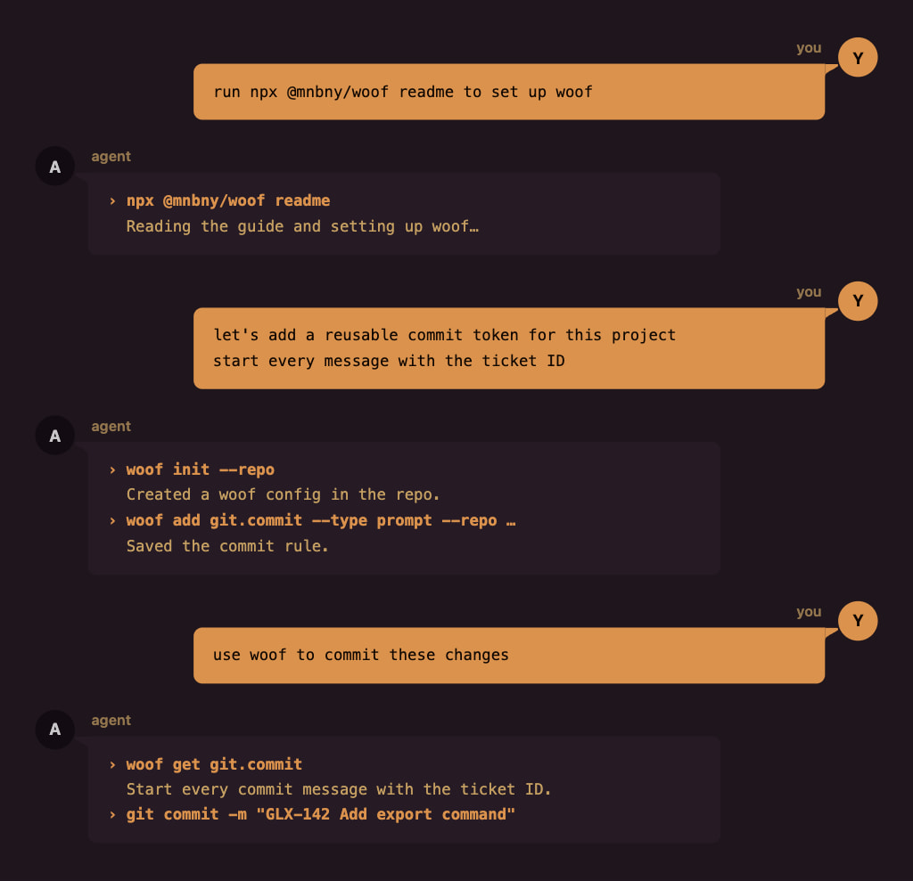

…but woof also has an interactive CLI if you want to run it yourself.

## How it works

### Shared defaults, project overrides

Your shared tokens live in your woof home, and your agent can find them from any project. A project overrides only what's different. Everything else comes from the shared tokens.

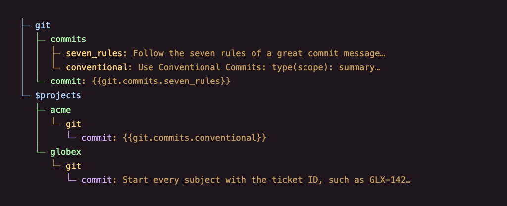

`acme` points the alias at the other shared rule. `globex` writes its own. Every other project keeps the seven rules.

Say `acme` is your team's repo. Its woof configuration lives in the repo, and everyone gets it through Git. `globex` is a client repo you can't commit to, so its configuration stays private in your woof home. woof finds it by path, worktrees included.

### Build instructions from pieces

Use `{{…}}` to include another token’s instructions, or `{{~…~}}` to have your agent fetch them later. Here’s what `agents.instructions` could say:

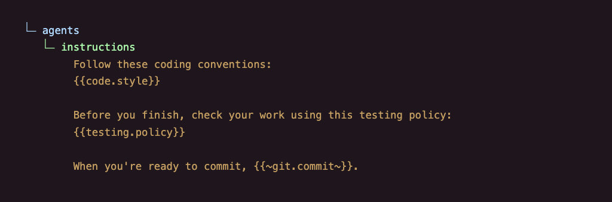

woof includes the coding conventions and testing policy when your agent reads this token. The last line tells your agent to fetch `git.commit` when it’s ready to commit.

Your AGENTS.md or CLAUDE.md shrinks to one line:

```text
Use the woof token `agents.instructions` and follow its instructions.
```

When your agent fetches the commit rules, `acme` gets Conventional Commits and `globex` gets the ticket rule. The same prompt works in both.

### Tokens that run

A token can also be a bash, node, tsx, or bun script. Some scripts feed your instructions. Others just do a job.

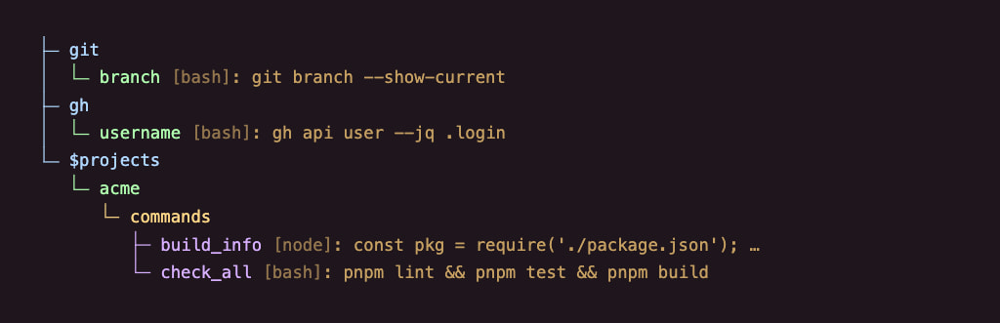

`You're on {{git.branch}}.` reads as `You're on feat/export.` `{{gh.username}}` gives your signed-in GitHub username. In `acme`, `commands.build_info` can report details from `package.json`, and “run the checks” uses `commands.check_all`.

Projects override scripts like any other token, so the same ask does the right thing in every repo.

### Ask in plain words

You don't have to remember token names. Give a token a description and tags, and your agent finds it by what it's for. Search reads only names, descriptions, and tags. It never loads every prompt or runs a script, so your agent fetches just the one it needs.

The companion skill, `woof-execution`, teaches your agent that loop: search, fetch, follow. It also writes tokens for you, so you never hand-edit JSON. Or Markdown. (Sorry, Markdown. It's not you, it's me.)

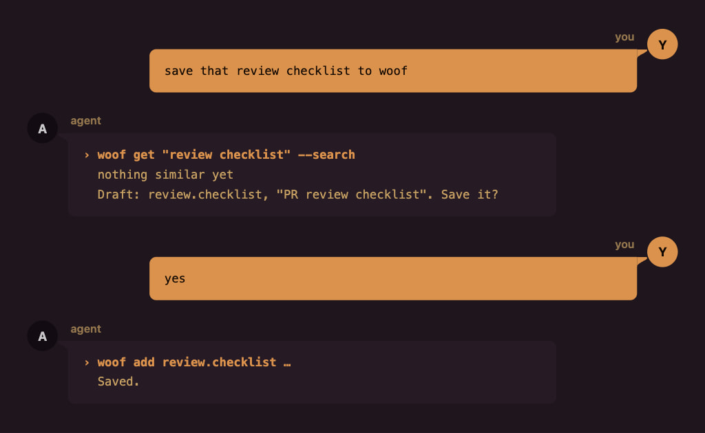

Edits, sharing, and repo setup work the same way. Your agent proposes, and you approve.

### Share with a coworker

If you can commit to a repo, like `acme`, keep its woof configuration there, and Git shares it with your team. Client repos are another story. Your agent instructions don't always belong in someone else's codebase, but your coworkers on that client could still use them. So keep the configuration in your woof home instead, like `globex`, and share it as a file.

Ask your agent to export it. woof packs the tokens and files `globex` needs into one zip:

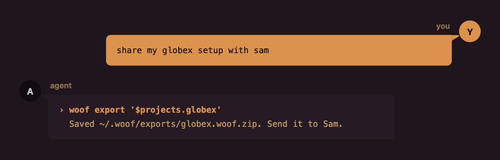

On Sam's side, anything new comes straight in. Anything that differs from what Sam already has waits for Sam's choice, one at a time:

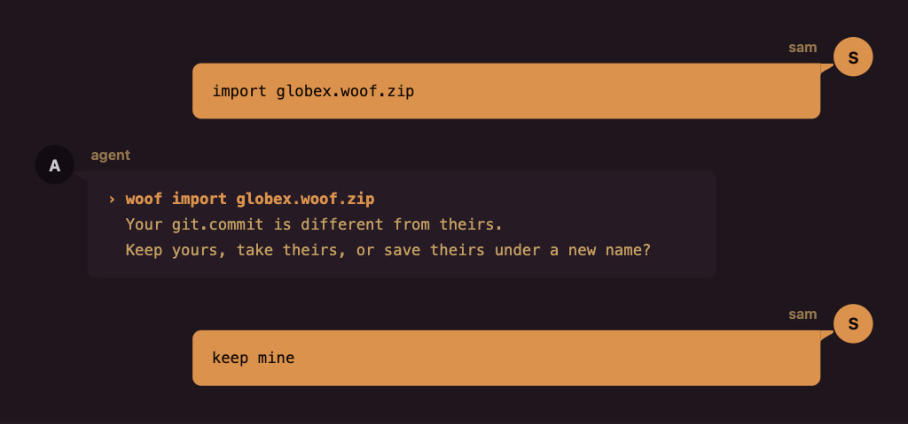

Before it writes anything, woof saves a backup.

For values Sam should supply, like a local preview URL, ask your agent to mark the token private before you share it. Sam gets a placeholder to fill in.

## Getting started

woof runs through npx, so there's nothing to install. You need Node.js 22.13+, 24, or 26+.

> [!NOTE]
>
> Paste this into your agent:
>
> ```text
> Run `npx @mnbny/woof@0.1.9 readme` and set up woof for me.
> ```

Your agent reads this guide. The first time it runs woof, woof suggests the companion skill, and your agent asks you before installing it.

Next, fill it up. woof is only as good as the tokens you give it, so start with primitives: the conventions, prompts, docs, and skills you already have. Point your agent at them, and it saves each one as a token:

- **"Save our commit rules to woof."** Your agent drafts the token, shows it to you, and saves it once you say yes.
- **"Add the docs in `docs/conventions/` to woof."** Each doc becomes a token with a name and a description your agent can search.
- **"Turn my code review skill into a woof token."** Its instructions are now available in every project.
- **"Point my AGENTS.md at woof."** It moves your instructions into tokens and leaves one line behind.

Then put them to work:

- **"What does woof have for code review?"** It searches names, descriptions, and tags, and shows you what fits.
- **"Use the woof token for code review."** It fetches the matching token and follows its instructions.
- **"Use woof to commit this."** It finds your commit convention and follows it.
- **"Set up woof for this repo."** It creates the repo's woof configuration, committed or private. Your call.
- **"Show me my shared git tokens."** Your agent shows an outline, with `...` for prompts and aliases and `###` for scripts.

## Under the hood

Everything below is plain JSON, and your agent writes it for you. Here's how it fits together, one piece at a time.

### Where tokens live

Your shared tokens live in one file in your woof home, `~/.woof/woof.config.json`. Your agent edits it through woof, and you can edit it by hand.

### Tokens

A token is a key in that file. Nested keys build its path:

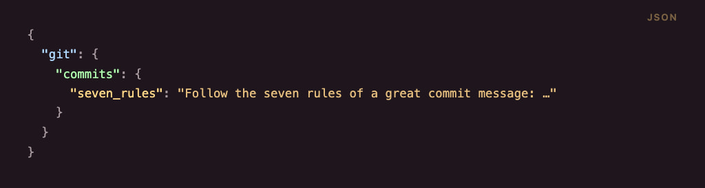

That's `git.commits.seven_rules`. A plain string is a prompt.

To help your agent find a token, swap the string for the long form, with a description and tags:

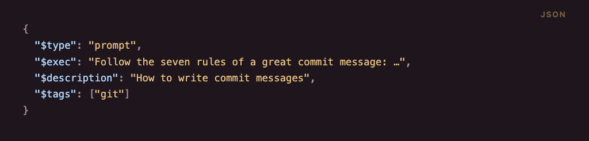

Keys that start with `$` belong to woof. Everything else is yours to name.

For a long prompt, keep it in a file. A plain string or `$exec` can point at it:

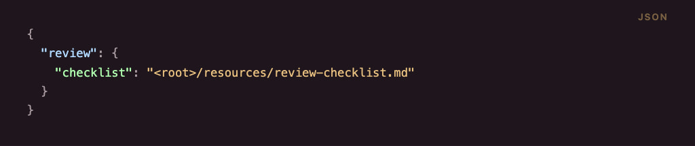

`<root>` is your woof home. In a repo's config, `<repo>` points at the repo.

### Aliases

A string that is exactly one reference is an alias:

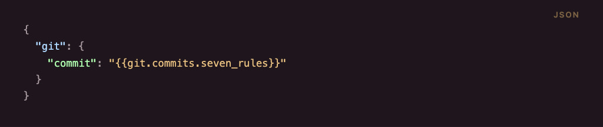

Point `git.commit` at a different token, and everything that uses it follows.

### Composites

References work anywhere in text:

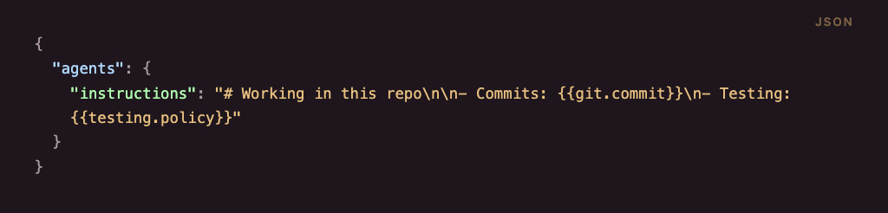

woof applies overrides first, then resolves references, so an override reaches every composite. Write `{{{{` and `}}}}` for literal double braces. A missing token or a cycle of immediate references fails before any script runs.

For an instruction your agent should fetch later, write `If you need the commit rules, {{~git.commit~}}.` woof turns the marker into an instruction to use that token. Your agent fetches it when needed.

### Scripts

Set `$type` to `bash`, `node`, `tsx`, or `bun`, and `$exec` becomes the script. Here's `git.branch`:

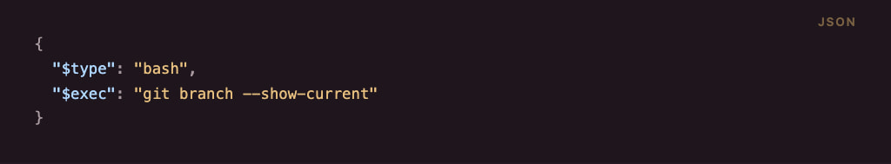

The script runs in the repo root, and its output becomes the value. `$exec` can also be a file, like `"<root>/scripts/checks.sh"`, or a list of scripts that run in order and stop at the first failure.

### Private values

You might keep `globex`'s local preview URL in woof. Ask your agent to mark that token private before you share it with Sam. It adds `$private` to the token:

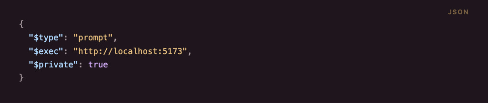

You still get the real value locally. The export replaces it with `{{-woof:private-}}`. Sam can import the configuration and ask their agent to fill in their own value. Until then, woof warns whenever their agent uses the token.

### Secrets

Some tasks need credentials, like an API key for `acme`'s tests. Add those values to your local woof secrets file, outside the conversation.

Once a token declares what it needs, you use it as usual. woof checks that the secrets are available and supplies them when needed. If something is missing, it tells you what to add locally.

Here's `checks.all` with `$secrets` connecting the saved `acme.tests` key to the `TEST_API_KEY` variable its tests use:

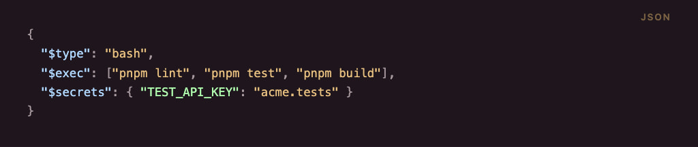

When your agent uses this token, woof supplies the key to those commands automatically.

A prompt can declare the same secret:

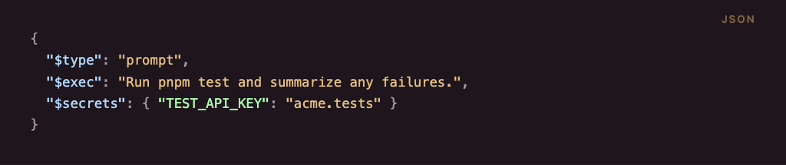

woof adds instructions telling your agent how to supply the key when it runs `pnpm test`. The value stays out of the prompt.

When you share the token with Sam, your credentials stay out of the export. Sam supplies their own values.

### Projects

A project changes tokens for one codebase. It holds only what's different, and everything else comes from your shared tokens. A project lives in one of two places.

#### In your woof home

A private project never enters the repo, so it works even where you can't commit, like `globex`. Ask your agent to set up a private woof project for the repo. It adds the project to your shared file under `$projects`, with the paths that select it:

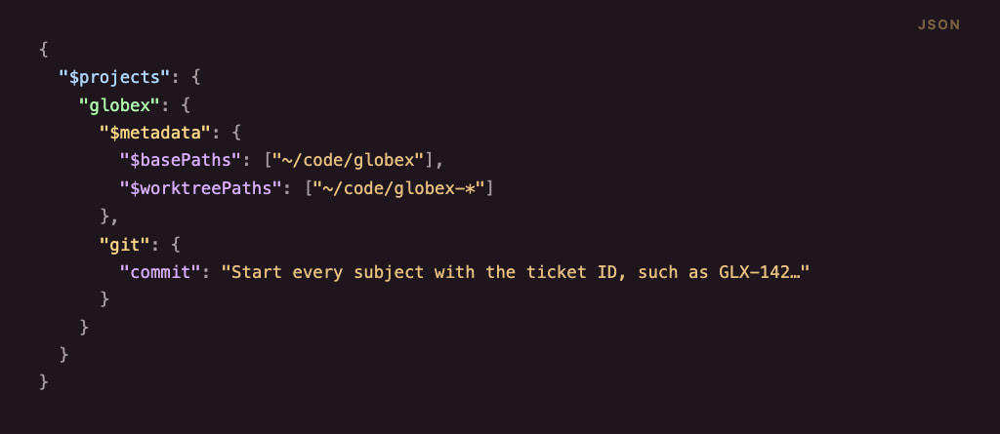

woof selects `globex` anywhere inside `~/code/globex`, and in every worktree that matches `~/code/globex-*`.

#### In the repo

Ask your agent to set up woof for the repo. It creates a `woof.config.json` at the repo root, or in `.agents/` or `.claude/`. Commit it, and woof uses it whenever you work inside the repo, in any clone or worktree, so your whole team gets it. Here's `acme`'s, which points one alias elsewhere:

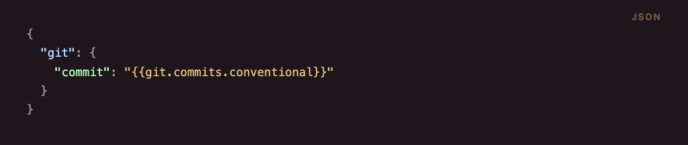

#### Which project applies

woof picks one project per run: the one you name, then the repo's own config, then the private project whose paths match. If nothing matches, your shared tokens apply alone.

## Reference

That's the tour. From here, it gets detailed fast: the full config, every rule, and every command. Your agent reads this part closely. You can skim.

### Config schema

Here's everything from the tour in one file, `~/.woof/woof.config.json`:

```json
{
  "$schemaVersion": 2,
  "git": {
    "commits": {
      "seven_rules": {
        "$type": "prompt",
        "$exec": "Follow the seven rules of a great commit message: …",
        "$description": "How to write commit messages",
        "$tags": ["git"]
      },
      "conventional": "Use Conventional Commits: type(scope): summary…"
    },
    "commit": "{{git.commits.seven_rules}}",
    "branch": {
      "$type": "bash",
      "$exec": "git branch --show-current"
    }
  },
  "testing": {
    "policy": "Run the tests before you push."
  },
  "checks": {
    "all": {
      "$type": "bash",
      "$exec": ["pnpm lint", "pnpm test", "pnpm build"]
    }
  },
  "review": {
    "checklist": "<root>/resources/review-checklist.md"
  },
  "agents": {
    "instructions": "# Working in this repo\n\n- Commits: {{git.commit}}\n- Testing: {{testing.policy}}"
  },
  "$projects": {
    "globex": {
      "$metadata": {
        "$basePaths": ["~/code/globex"],
        "$worktreePaths": ["~/code/globex-*"]
      },
      "git": {
        "commit": "Start every subject with the ticket ID, such as GLX-142…"
      }
    },
    "initech": "<root>/projects/initech.json"
  }
}
```

And `acme`'s repo config:

```json
{
  "$schemaVersion": 2,
  "git": {
    "commit": "{{git.commits.conventional}}"
  }
}
```

#### Values

| Value | Example | Means |
| --- | --- | --- |
| String | `"Run the tests before you push."` | Prompt |
| String that is exactly one reference | `"{{git.commits.seven_rules}}"` | Alias |
| String with references inside | `"Commits: {{git.commit}}"` | Composite prompt |
| String that starts with `<root>/` or `<repo>/` | `"<root>/resources/review-checklist.md"` | Prompt read from a file |
| Object with `$type` | `{ "$type": "bash", "$exec": "…" }` | Resource: a prompt or a script |
| Any other object | `{ "commits": { … } }` | Namespace |

#### Reserved keys

| Key | Belongs in | Value |
| --- | --- | --- |
| `$schemaVersion` | Every config file, at the top level | `2` |
| `$type` | A resource | `prompt`, `bash`, `node`, `tsx`, or `bun` |
| `$exec` | A resource | Prompt text, script source, or a `<root>/` or `<repo>/` file. Scripts also take a list. |
| `$description` | A resource | Optional text for search |
| `$tags` | A resource | Optional list of strings for search |
| `$private` | A resource | Optional boolean. `true` replaces the content with `{{-woof:private-}}` on export. |
| `$secrets` | A resource | Optional map of environment variable names to local secret keys. Values stay in the secrets store. |
| `$arguments` | A script resource | Optional ordered list of objects with `name` and optional `description`, documenting positional arguments and flags. |
| `$projects` | Your shared file | Private projects by name: inline, or a `<root>/` path to the project's own file, like `initech` |
| `$metadata` | A private project | Optional `$basePaths` and `$worktreePaths` |
| `$basePaths` | `$metadata` | Paths that select the project, including everything below them |
| `$worktreePaths` | `$metadata` | Patterns that match the current directory or one of its parents |

#### Secret bindings

- `$secrets` maps environment variable names to paths in `~/.woof/woof.secrets.json`. Prompt and script resources support it. Bindings contain names only.
- The secrets file uses the same nested namespaces and token names as the configuration. Values are literal strings. woof creates an empty file with owner-only permissions (`0600`) when it initializes your home, including when your config already exists. Existing files stay untouched. If permissions prevent creation, commands without secret dependencies can still run.
- The secrets file has no `$schemaVersion` and takes no migrations. Dots separate names in a path; they cannot appear in JSON keys. Environment names use letters, digits, and underscores and cannot start with a digit. `CI`, `npm_config_*`, and prototype-sensitive names are reserved.
- Reference checks require every declared key to have a nonempty value. Missing values fail `get`, `explain`, `validate`, authoring, and export. Errors identify the token, environment name, and key without displaying values.
- `get` checks all immediate dependencies before any script runs. It checks deferred targets' dependencies when retrieved. `validate` follows deferred references too.

#### Template strings

| Form | Meaning |
| --- | --- |
| `{{path}}` | Inserts the resolved token content. Referenced scripts run during lookup. |
| `{{~path~}}` | Writes an instruction to use the token later. Checks that it exists without loading or running it. |
| `{{-woof:private-}}` | Marks private content omitted during export. Lookup asks for a replacement value. |
| `{{-…-}}` | Reserved for internal markers. Unknown markers stay literal. |
| `{{{{path}}}}` | Outputs literal `{{path}}`. The same escaping works for deferred references and internal markers. |

Deferred instructions include the project name when a registered project is selected. Repository-project and shared-only lookups keep plain addresses; retrieve those from the same project context. Validation checks deferred dependencies fully, export includes them, and import updates their addresses when remapped. Only immediate reference cycles fail.

#### Rules

- Token names use ASCII letters, digits, `_`, and `-`, and they're case-sensitive. Dots join names into a path.
- An unknown `$` key fails.
- A value is a string, a resource, or a namespace. Numbers, booleans, `null`, and bare arrays fail.
- `<root>` is your woof home. `<repo>` is the root of the selected project's checkout: the current checkout inside the project's paths, or else the project's first base path that exists. Without either, `<repo>` files fail. Shared tokens can't use `<repo>`. A file path can't be absolute or empty, can't use `..`, and must resolve to a regular file inside its root.
- Paths in `$basePaths` and `$worktreePaths` are absolute or start with `~/`. woof ignores paths that don't exist on your machine, so teammates can list their own.
- Shared tokens must resolve without a project. They can't reference project-only tokens or `<repo>` files.
- An override replaces the whole token, including its description and tags. A project can't replace a shared namespace with a token, or a token with a namespace.
- A missing target or a cycle of immediate references fails before any script runs. A token that inserts its own value is a cycle.
- `{{-...-}}` is reserved for internal markers. Add and import remapping reject token addresses that produce this syntax, such as `-draft-`. Write `{{{{-woof:private-}}}}` to show the private marker literally.
- A checkout holds one repo config: `woof.config.json`, `.agents/woof.config.json`, or `.claude/woof.config.json`. Two different files fail.
- Every config file declares `"$schemaVersion": 2`. woof never upgrades a file on its own. When it asks for a migration, rerun the command with `--migrate`.

### Commands

Your agent runs these as `npx @mnbny/woof@0.1.9 <command>`. Add `--help` to any command for its full options.

| Command | What it does | Options |
| --- | --- | --- |
| `woof readme` | Prints this guide. Agents run it first. | — |
| `woof get [query…]` | Prints a token's value when the query is its exact path. Otherwise, searches. | `--search` to always search, `--project <name>`, `--args <text>` |
| `woof tree [path]` | Shows token structure without content | `--project <name>` or `--repo` |
| `woof add [path]` | Adds a token | `--type`, `--content`, `--description`, `--tag`, `--arguments`, `--secret`, `--private`, and one of `--shared`, `--repo`, or `--project <name>` |
| `woof edit [path]` | Changes a token's content, metadata, or privacy | `--content`, `--description`, `--tag`, `--arguments`, `--secret`, `--private` or `--no-private`, `--shared` or `--override`, `--project <name>` |
| `woof init [location]` | Creates a repo config or a private project | `--repo`, or `--name <name>` with `--base-path` and `--worktree-path` |
| `woof secret KEY` | Reads one local secret for command substitution | — |
| `woof projects` | Shows which project the current directory selects, and lists private projects | — |
| `woof explain [path]` | Traces how a token resolves, without running scripts | `--project <name>` |
| `woof validate [path]` | Checks every token, or one token's graph, without running scripts | `--project <name>` |
| `woof export` | Packs a private project into a zip in `~/.woof/exports/` | `--project <name>` |
| `woof import <archive>` | Asks about each conflict in an archive, then applies it | `--decisions <file>` |

Every command takes `--agent`. All commands except `secret` also accept `--migrate`. `woof --help` and `woof --version` work too.

#### Options

- `--content` takes text, the path of an existing file, or `-` to read standard input.
- `--tag`, `--base-path`, and `--worktree-path` repeat: `--tag git --tag commits`.
- In `edit`, an empty `--description` or `--tag` removes it. `--shared` changes a shared token for every project, and `--override` overrides it in the selected project only.
- `--private` on `add` or `edit` sets `$private: true`. `edit --no-private` removes the field. Other edits preserve the privacy setting. Disabling privacy alone on an already public definition makes no change.
- `--secret ENV_NAME=secret.key` on `add` or `edit` declares a secret binding. Repeat it for multiple bindings. On edit, the flags replace the entire binding set; `--secret ''` removes it. Omitting the flag preserves existing bindings. Supply names only, never values.
- `--arguments '[{"name":"platform","description":"Platform to build"}]'` on `add` or `edit` sets `$arguments`. On edit, it replaces the list; `--arguments '[]'` clears it. Omit the flag to preserve it.
- In `tree`, `--project` and `--repo` show only that project's own definitions. An optional exact path selects a branch or leaf.
- A qualified address, such as `'$projects.globex.git.commit'`, selects a project the same way `--project globex` does. Quote it so the shell leaves `$projects` alone. Tree paths instead start at the selected scope.

#### Agent mode and exit status

- woof detects coding agents from markers in their environment. `--agent` covers any other caller.
- Agent mode runs the same operations, with plain text and no questions.
- When a command needs a decision, it prints the choices and the exact command to continue, writes nothing, and exits with status 1.
- `get` prints the value exactly as resolved, so you can pipe it.
- Exit status is `0` on success, `1` on a failure or a handoff, and `130` on a cancellation.

#### Secret lookup

For commands described by a prompt, the agent prepends the environment assignments supplied by `get`:

```sh
TEST_API_KEY="$(woof secret 'acme.tests')" pnpm test
```

- Use the same woof executable or package invocation that retrieved the prompt.
- `secret` writes only the requested value to stdout, with no added newline, in both human and agent mode. Errors go to stderr, leave stdout empty, and exit with status 1.
- Lookup reads the secrets file without initializing or loading the token catalog.
- Use lookup inside command substitution. Do not run it on its own in an agent session or enable shell tracing. The command must read the supplied environment variables.
- Shell command substitution removes trailing newlines. Direct script-token execution preserves them.
- Agents must not open or display the secrets file, print values, or ask for values in a conversation. Scripts must not log credentials; woof does not mask their output.

#### Export and import

- Export starts with the selected project's tokens and follows their references after applying overrides. It omits unrelated shared tokens, overridden defaults, and unused files. An empty project exports no shared tokens.
- A shared token that depends on a project override, directly or through another token, exports as a project token. Independent shared dependencies stay shared.
- For each exported token with `$private: true`, woof replaces `$exec` with `{{-woof:private-}}` and keeps the token's address, type, metadata, and privacy flag. Files and references used only by the omitted content stay out of the archive.
- Privacy applies only to the marked token. An unmarked token can still export the same file. Local values and source files stay unchanged, and recovery backups retain private values.
- Import warns about placeholders and continues. A differing value at the same address in the same layer needs conflict review. A new project token is added even if it overrides a shared token.
- Each lookup that reaches a private placeholder names the token, asks for its value, and warns on stderr. Replacing the marker with `woof edit` stops the warning and preserves the privacy flag.
- Export keeps secret bindings but excludes the secrets file and values. The file cannot serve as a token resource or import destination, and import backups exclude it.
- Import can save bindings before local values exist. Post-import validation reports missing secrets as setup findings without undoing the import.

### Scripts

A script token runs each time your agent gets it, and whatever it prints becomes the value.

#### Runtimes

- `bash`: your bash.
- `node`: the same Node.js that runs woof.
- `tsx`: TypeScript through a pinned tsx, from npx. It doesn't type-check.
- `bun`: a pinned Bun, from npx.

#### Where the script lives

`$exec` holds the script itself, or points at a file:

- `<root>/…`: a file in your woof home.
- `<repo>/…`: a file in the selected project's checkout. Project tokens only.

#### Notes

- Scripts run in the selected project's checkout, the same root as `<repo>`. Without one, they run in the current repo root, or in the current directory outside a repo.
- `woof get scripts.build --args 'ios --variant "woof alt"'` passes arguments to every script executed in that lookup. Quotes group values containing spaces. Scripts interpret and validate their own arguments; prompts ignore them.
- Optional `$arguments` descriptions list positional names in order and flags in any order. Search shows `[has arguments]`; `woof explain` shows the descriptions. Scripts can accept arguments without declarations.
- Bash scripts read arguments through `$1`, `$2`, and `"$@"`. Node, tsx, and bun scripts use `process.argv.slice(1)` for inline source and `process.argv.slice(2)` for files.
- Each script receives its own declared secrets in its environment. Bindings override matching inherited variables without changing woof's environment. Two scripts can bind the same variable to different keys. An inherited variable does not replace a missing store entry.
- A list of scripts runs in order and stops at the first failure.
- A private placeholder returns a request for the missing value without starting a runtime. If any entry in a script list is a placeholder, none of the list runs.
- The first `tsx` or `bun` run may need the network.
- If a script fails, the lookup fails. woof doesn't undo what a script already did, and there's no timeout.
- `get` runs script tokens. Searching, `explain`, `validate`, and `secret` do not execute scripts.

### Files and folders

Everything woof keeps lives in your woof home, `~/.woof`.

#### In your woof home

- `woof.config.json`: your shared tokens and private projects.
- `woof.secrets.json`: local secret values in nested namespaces, excluded from exports and import backups.
- `resources/`: files woof copied in for your tokens.
- `exports/`: archives from `woof export`.
- `.backups/`: backups that `woof import` saves before it writes.

#### In a repo

- `woof.config.json`, `.agents/woof.config.json`, or `.claude/woof.config.json`: the repo's project. Keep only one.

#### Notes

- woof creates its home, `woof.config.json`, and an empty `woof.secrets.json` the first time it needs them. Later operational commands create either file if it is missing. Help, version, and readme skip initialization unless you pass `--migrate`. Single-secret lookup always skips it.
- woof keeps every backup. To restore one, extract it over woof home.

### Limits and decisions

#### Limits

What woof doesn't do yet:

- There's no rename, move, or delete command. Edit the JSON by hand, or ask your agent to, then run `woof validate`.
- One project applies per run, so you can't layer personal overrides on top of a repo's config.
- On Windows, cancelling a script stops the script itself but not the processes it started. macOS and Linux clean up everything.
- The `woof edit` page loads its styles from a CDN, so it's unstyled offline.

#### Deliberate decisions

What woof does on purpose:

- An override replaces the whole token. To build on a shared value, reference its pieces from your override. A token can't insert its own value.
- A change to a shared token reaches every project at once, the way a design token does. There's no version pinning.
- Repo configs travel through Git. Only private projects export.
- Script output is plain text. woof never looks for references in it.
- An immediate reference to a script runs it on every lookup, so keep scripts with side effects out of those compositions.
- Scripts run as you, with no sandbox, timeout, or undo. Before you get tokens from an unfamiliar repo, check its config with `woof explain`.
- Search matches names, descriptions, and tags as text. It isn't semantic, so good descriptions pay off.
- woof borrows design-token ideas, not the DTCG file format, so DTCG tools can't read woof files.
- woof runs locally and never calls a model. Your agent does the thinking.

## Development

```sh
git clone https://github.com/mnbny/woof.git
cd woof
pnpm install
node cli/setup.mjs # links ~/.local/bin/woof to this checkout
pnpm validate      # formats, lints, typechecks, and builds
pnpm test
```

Design notes for contributors and agents live in [`.agents/docs/`](.agents/docs/index.md).

## ...and why "woof"?

<table>
  <tr>
    <td>After this interaction, I refer to my agents as woof.</td>
    <td></td>
  </tr>
</table>
